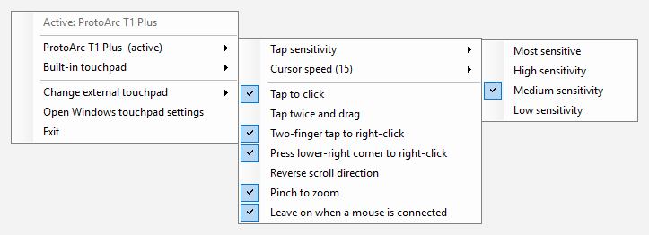

# Touchpad Control

Separate touchpad settings for an external touchpad and your laptop's built-in one on Windows 10/11.

> **Windows only.** Touchpad Control uses Windows' Precision Touchpad settings and Task Scheduler, so it
> doesn't work on macOS or Linux.

**[Download the latest release](https://github.com/badbatchx85/touchpad-control/releases/latest)**

Windows keeps **one** set of Precision Touchpad settings for every touchpad. Plug in an external pad
(Apple Magic Trackpad, ProtoArc T1, Logitech T650, ...) and it shares tap sensitivity, cursor speed and
tap-and-drag with your laptop's pad, even though the two often need different settings.

Touchpad Control keeps two profiles and switches between them automatically:

- **External**: applied when your external touchpad connects
- **Built-in**: applied when it disconnects

A notification-area icon shows which profile is active (blue = external, grey = built-in). Right-click it
to edit either profile, even the one that isn't active right now.



## What you can change per touchpad

- Tap sensitivity (Most / High / Medium / Low)
- Cursor speed (1-20)
- Tap to click, tap twice and drag, two-finger tap to right-click, lower-right corner right-click
- Scroll direction, pinch to zoom, leave on when a mouse is connected

Anything you change in **Settings > Bluetooth & devices > Touchpad** is saved into the active profile too.

## Requirements

- Windows 10 or 11 (not macOS or Linux) with a Precision Touchpad (most laptops since ~2017)
- An external touchpad that Windows treats as a Precision Touchpad
- Windows PowerShell 5.1 (built in). No admin rights or extra installs needed.

## Install

1. Download `touchpad-control-<version>.zip` from the
   [latest release](https://github.com/badbatchx85/touchpad-control/releases/latest) and extract it to a folder
   you'll keep, for example `%USERPROFILE%\Tools\touchpad-control`. (Cloning the repository works too.)
   The logon task runs the script from that folder, so don't move it afterwards (or run `install` again if you do).
2. Open PowerShell in that folder and run:

   ```powershell
   powershell -ExecutionPolicy Bypass -File .\TouchpadControl.ps1 install
   ```

3. Right-click the new touchpad icon in the notification area (it may be under the **^** arrow),
   choose **Choose external touchpad...** and pick your touchpad from your paired Bluetooth devices.

Touchpad Control starts automatically every time you sign in.

## Commands

```powershell
.\TouchpadControl.ps1 install            # start at logon and run now
.\TouchpadControl.ps1 tray               # run the tray app in this session only
.\TouchpadControl.ps1 status             # device, live settings and both profiles
.\TouchpadControl.ps1 apply builtin      # apply a profile now (external | builtin)
.\TouchpadControl.ps1 save external      # save the current settings into a profile
.\TouchpadControl.ps1 uninstall          # remove the logon task, restore your original settings
```

Run them with `powershell -ExecutionPolicy Bypass -File` if script execution is blocked on your PC.

## Uninstall

```powershell
powershell -ExecutionPolicy Bypass -File .\TouchpadControl.ps1 uninstall
```

This stops the tray app, removes the logon task and restores the touchpad settings you had before installing.
Your profiles stay in `%APPDATA%\TouchpadControl`; delete that folder to remove them.

## How it works

- Settings are read and written with the documented `SPI_GETTOUCHPADPARAMETERS` / `SPI_SETTOUCHPADPARAMETERS`
  calls, so changes apply instantly, the same way the Settings app does it.
- Every 3 seconds the tray app checks whether the chosen device is connected (`DEVPKEY_Device_IsConnected`
  for Bluetooth; for other devices, whether the device is present) and switches profiles when that changes.
- Before switching, the live settings are saved into the profile being left, so tweaks made in Windows
  Settings are kept.
- Data lives in `%APPDATA%\TouchpadControl`: `profiles.json`, `device.json`, a backup of your original
  settings and a small log.

## Limitations

- The device picker lists paired Bluetooth devices. For a USB touchpad, put its device instance ID
  (Device Manager > device > Details > *Device instance path*) into `%APPDATA%\TouchpadControl\device.json`:

  ```json
  { "id": "HID\\VID_XXXX&PID_XXXX\\...", "name": "My USB touchpad" }
  ```

- Windows applies one set of settings at a time, so while the external touchpad is connected, the built-in
  pad also uses the external profile.

## License

MIT
